# 낯선 밑줄

모르는 사람과 전자책 한 권, 일기장 한 권을 천천히 주고받는 익명 교환독서·교환일기 웹앱.

> **바로 써 보기: https://exchange-reading.vercel.app**
>
> 설치나 로그인 없이 브라우저(휴대폰·PC)에서 주소를 열면 바로 홈이 나옵니다.
> 일반 창·시크릿 창·다른 브라우저는 각각 다른 익명 사용자가 되므로, 창 2~3개로 "낯선 사람"끼리의 함께 읽기·교환일기를 바로 해 볼 수 있습니다.

## 1. 제작한 것 소개

**낯선 밑줄**은 친구끼리 하던 교환독서를 낯선 사람과의 경험으로 바꾼 익명 슬로우 소셜 웹앱입니다.

교환독서는 한 권의 책을 돌려 읽으며 밑줄과 메모를 남기는 놀이입니다. 그런데 아는 사람끼리는 생각이 닮아 있고, 속마음을 적기엔 부끄럽고, 같이 할 사람이 없으면 시작조차 못 합니다. 그래서 이름도 얼굴도 없이 **펜 색으로만 구분되는 낯선 사람**과 책과 일기를 주고받게 했습니다.

### 주요 기능

| 홈 | 함께 읽기 | 블라인드 | 교환일기 |
|---|---|---|---|
| 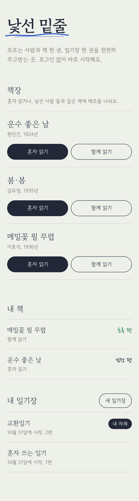 | 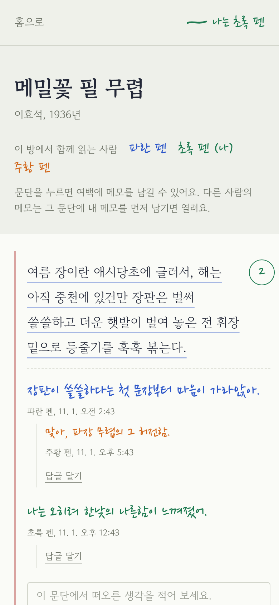 | 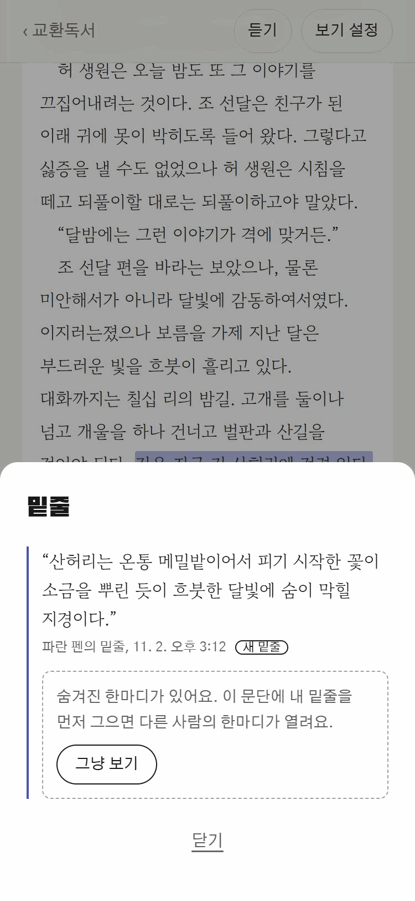 | 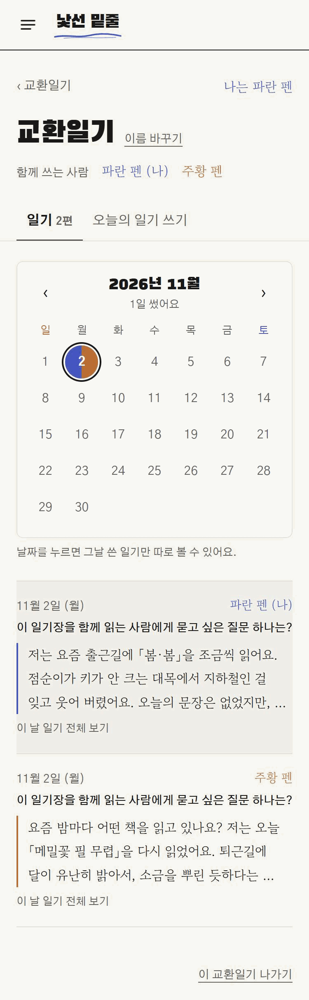 |

> 스크린샷은 배포 주소(exchange-reading.vercel.app)에서 README용 예시 데이터로 찍은 휴대폰(375px) 화면입니다. 처음 화면(PC)만 PC 크기로 찍었습니다. (11/2, 23단계 기준)

**로그인 없이 시작** — 처음 접속하면 화면 뒤에서 익명 계정이 만들어지고 그 브라우저에 기억됩니다(Supabase 익명 로그인).

**책 읽기** — 저작권이 끝난 한국 단편 8편(운수 좋은 날, 봄·봄, 메밀꽃 필 무렵, 날개, 동백꽃, B사감과 러브레터, 감자, 벙어리 삼룡이)을 문단 단위로 읽습니다. 문단을 누르면 여백에 메모(300자)를 남기고, 오른쪽 여백에 메모 개수가 동그라미로 표시됩니다.

| | 혼자 읽기 | 함께 읽기 |
|---|---|---|
| 방 | 나만 있는 방. 같은 책을 다시 열면 같은 방 | 같은 책의 빈자리 있는 방(최대 3명). 없으면 새 방 |
| 펜 색 | 검정 펜 | 남은 색 중 하나: 파란 펜 · 초록 펜 · 주황 펜 |
| 메모 | 나만 봅니다 | 같은 방 사람들이 펜 색별로 봅니다 |
| 블라인드 | — | 내 메모가 없는 문단은 "숨겨진 메모 N개"로만 보입니다. 내가 먼저 쓰거나 "그냥 보기"를 누르면 열립니다 |
| 답글 | — | 메모 아래 한 단계 답글 |

**일기 쓰기** — 날마다 바뀌는 "오늘의 질문"(10개 순환)을 보며 공책 줄 위에 1,000자 이내로 씁니다.

| | 혼자 쓰기 | 교환일기 |
|---|---|---|
| 시작 | 바로 내 일기장이 생깁니다 | 기다리는 사람이 있으면 바로 짝. 없으면 "짝을 기다리는 중" |
| 쓰기 | 언제든 | 번갈아 한 편씩. 마지막 글이 내 글이면 "짝의 답장을 기다리는 중"으로 잠깁니다 |
| 홈 표시 | 편 수 | "내 차례" · "짝의 차례" · "짝을 기다리는 중" (알림 대신) |

### 형광펜 (22단계)

- **형광펜** — 문장을 고르면 밑줄 긋기와 형광펜 칠하기 중에 고른다. 형광펜도 내 펜 색으로 칠해지고, 누르면 밑줄처럼 한마디·답글이 열린다.

### 새 디자인 (17단계)

- 참고 이미지의 느낌으로 앱 전체를 다시 꾸몄다. 처음 화면의 입자감 있는 책등 세 권을 누르면 교환독서·교환일기·독서 달력으로 간다.
- 사이드바는 아이콘 메뉴, 책장은 색 표지가 있는 흰 카드로 바꿨다. 책 본문과 일기는 읽기 편한 고운바탕으로 두었고, 21단계에서 손글씨 글꼴을 없애 밑줄 한마디·답글·편지도 같은 글꼴로 맞췄다. 자세한 내용은 [`docs/DESIGN.md`](docs/DESIGN.md)에 있다.

### 듣기 (16단계)

- **듣기(TTS)** — 리더의 "듣기" 버튼으로 지금 읽는 문단부터 기기의 음성으로 읽어 준다. 멈추기, 앞·다음 문단, 속도, 목소리를 고를 수 있고 읽는 문단을 화면이 따라간다. 브라우저 음성(Web Speech API)을 쓰므로 목소리는 기기마다 다르고, 한국어 음성이 없는 기기에서는 쓸 수 없다.

### 내 취향대로 보기 (14단계)

- **쪽 수 고르기** — 페이지 모드에서 자동·한 쪽·두 쪽을 고른다. 두 쪽은 화면 너비 700px 이상에서 보인다.
- **책장 배치** — 목록·3열·4열 중에서 고르고, 브라우저에 기억한다. 목록은 읽기 버튼이 책 옆에 있다. 표지 이미지가 없는 책은 제목과 저자로 만든 글자 표지를 쓴다.
- **책 머리 글자** — 글자 크기를 바꾸면 책 제목과 안내 글도 같은 비율로 바뀐다.

### 읽는 화면 다듬기 (13단계)

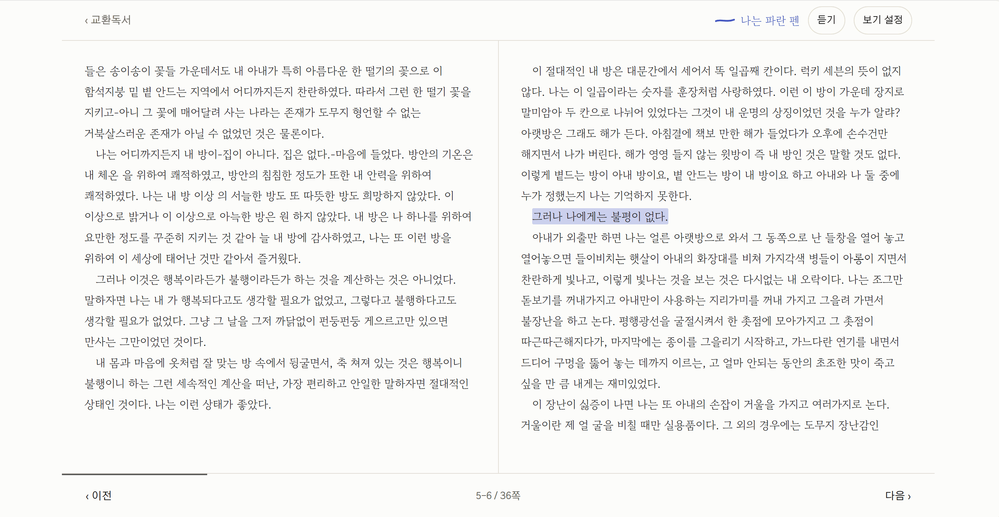

> PC에서 페이지 모드로 읽을 때 펼친 책처럼 두 쪽이 나란히 보이는 화면입니다.

- **두 쪽 보기** — 화면이 넓으면(900px 이상) 페이지 모드가 펼친 책처럼 두 쪽씩 보이고 두 쪽씩 넘어간다.
- **글자 크기 픽셀 지정** — 12~40px을 직접 넣거나 ±로 맞춘다. 작게·보통·크게 바로가기도 있다.
- **책 끝 정돈** — 페이지 모드의 편지·다음 책 쪽을 가운데에 놓고, "이 방 나가기"를 눈에 띄는 버튼으로 바꿨다. 스크롤 모드 본문 옆의 색 띠는 없앴다.

### 오래 함께하기 (12단계)

- **같은 사람들과 다음 책** — 함께 읽기 책 끝에서 다음 책을 제안하고, 방 사람 모두가 좋다고 하면 같은 펜 색으로 새 방이 열린다. 서로 누구인지는 끝까지 모른다. 거절은 상대에게 따로 알리지 않는다.
- **나의 독서 달력** — 언제 얼마나 읽고 썼는지(읽은 문단, 밑줄, 답글, 편지, 일기)를 나만 보는 달력에 쌓는다. 점수나 연속 기록은 없다.

### 오래 쓰기 위한 기능 (10단계)

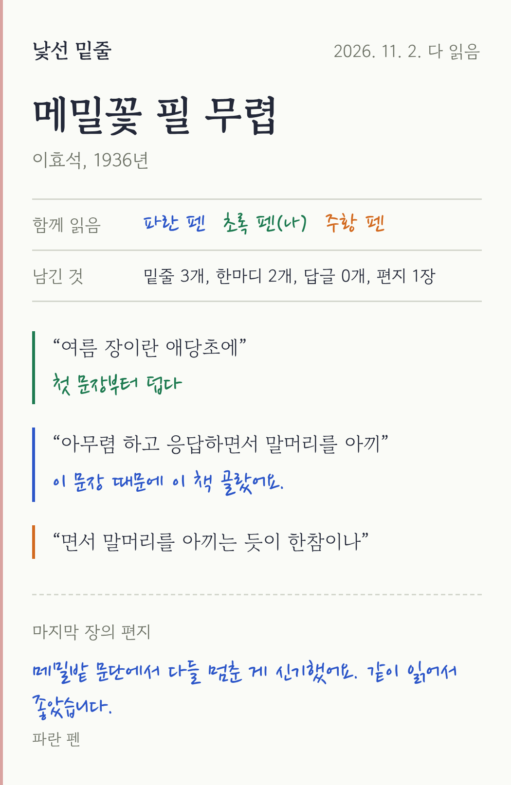

- **나만의 열쇠** — 로그인이 없어서 브라우저를 바꾸면 기록에 다시 들어갈 수 없다. "나만의 열쇠"(12자)와 복구 링크를 만들어 두면, 다른 브라우저에서 열쇠를 넣어 내 책·일기장·짝과의 교환일기를 그대로 옮겨 온다. 열쇠는 DB에 해시로만 저장하고, 원문은 그 브라우저에만 기억해 `/key`에서 언제든 다시 볼 수 있다.
- **짝이 멀어졌을 때** — 교환일기에서 짝의 차례로 7일 넘게 멈추면 "짝이 잠시 멀어졌어요. 기다릴까요, 마무리할까요?"를 묻고, 조금 더 기다리기·마무리하기·마무리하고 새 짝 찾기를 고른다. 마무리해도 지난 일기는 두 사람 모두 볼 수 있다.
- **다 읽은 뒤 기념 카드** — 책 끝에서 함께 그은 밑줄·한마디·편지를 독서 영수증 한 장으로 모아 이미지로 저장하거나 공유한다. (20단계에서 대출 카드 모양을 영수증으로 바꿈)
- **책장 넓히기** — 이상 「날개」, 김유정 「동백꽃」, 현진건 「B사감과 러브레터」, 김동인 「감자」, 나도향 「벙어리 삼룡이」를 더해 8권. 저작권 보호기간이 끝난 작품만 넣는다.

<br clear="right" />

### 사용 후 개선 (9단계)

| 책처럼 넘기는 페이지 | 밑줄에 한마디 | 날짜별 일기·댓글 |
|---|---|---|
| 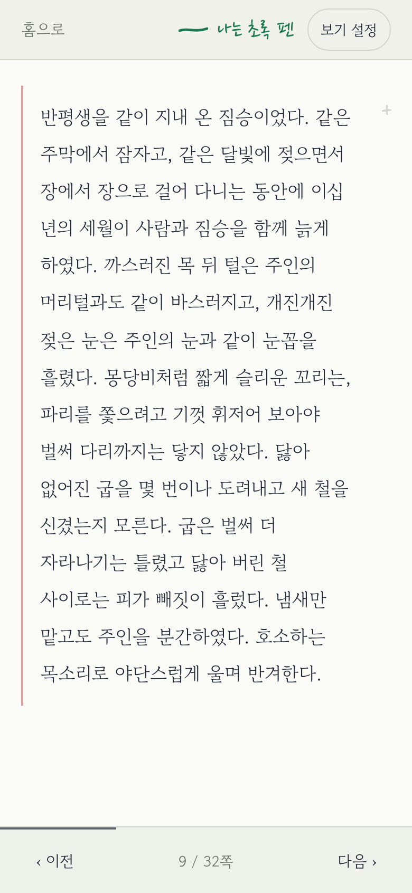 | 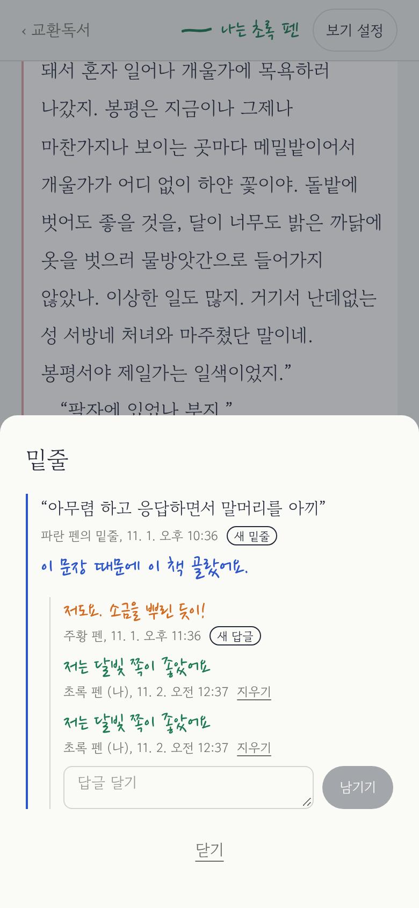 | 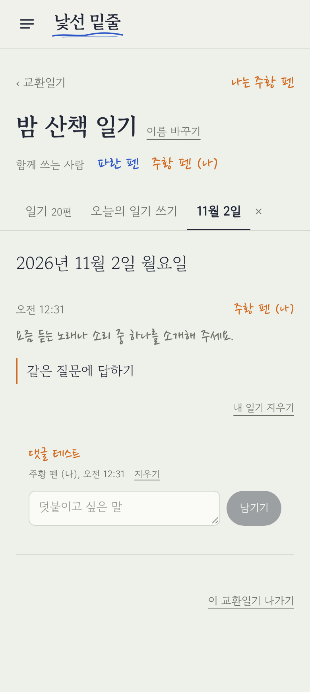 |

- **책처럼 넘기는 페이지** — 글이 문단을 넘어 쪽으로 이어진다(빈자리 없음). 화면 가장자리를 누르거나 밀어서 넘긴다.
- **밑줄에 한마디** — 문장에 밑줄을 그을 때 짧은 한마디를 붙일 수 있다. 밑줄을 누르면 한마디와 답글이 열린다. 함께 읽기에서는 그 문단에 내 밑줄을 먼저 그어야 남의 한마디가 보인다(블라인드). 문단 메모는 이것으로 대신했다.
- **일기장 이름 바꾸기**, **내 일기 지우기**, **일기마다 댓글**.
- **같은 질문** — 교환일기는 두 사람이 같은 질문에 한 번씩 답한 뒤 다음 질문으로 넘어간다.
- **날짜별 탭** — 달력에서 날짜를 누르면 그날 쓴 일기만 따로 보는 탭이 열린다.

### 화면 구조 (8단계)

| 처음 화면 (PC) | 일기 달력 |
|---|---|
| 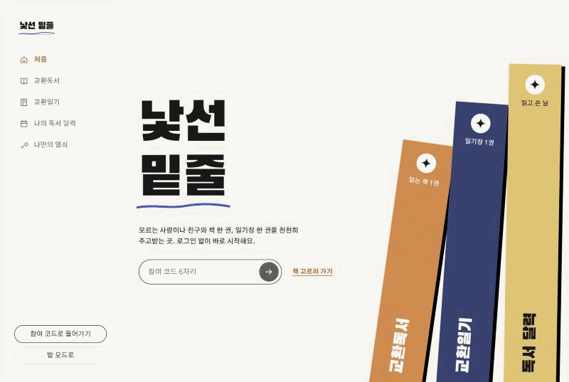 | 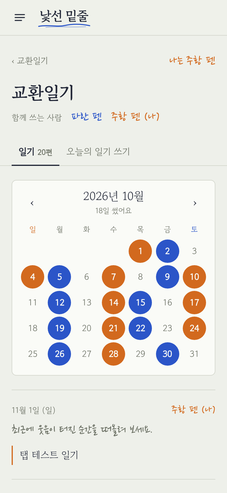 |

- **처음 화면**에서 교환독서와 교환일기 중 하나를 고른다. 왼쪽 **사이드바**(휴대폰은 ☰)로 언제든 오갈 수 있다.
- **교환독서**(`/read`): 내 책, 책장. **교환일기**(`/diary`): 내 일기장, 새 일기장 시작하기(혼자 · 낯선 사람과 · 아는 사람과 코드로).
- **일기장**은 "일기" 탭이 먼저다. 달력에 일기를 쓴 날이 쓴 사람의 펜 색으로 칠해지고(교환일기에서 둘 다 쓴 날은 반반), 날짜를 누르면 그날 일기로 간다. 쓰기는 "오늘의 일기 쓰기" 탭에서.

### 마감 후 추가한 기능 (7단계)

| 페이지로 읽기 | 밤 모드 | 문장 밑줄 | 다 읽고 편지 |
|---|---|---|---|
|  | 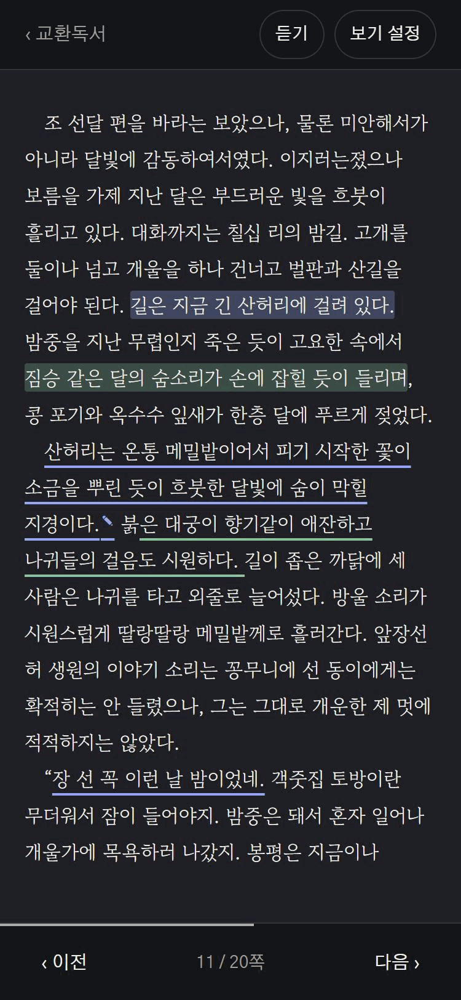 | 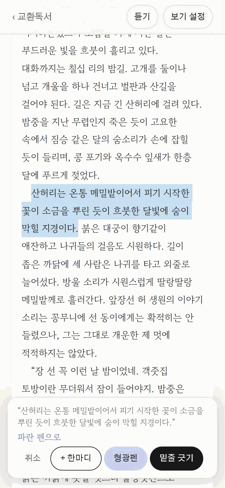 | 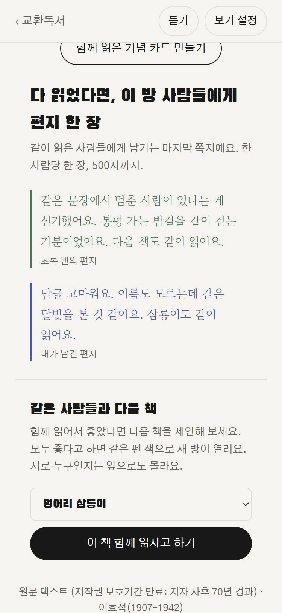 |

- **읽는 방식 고르기** — "보기 설정"에서 스크롤 또는 페이지. 페이지는 좌우로 밀거나 ‹ › 버튼·키보드 ← →로 넘기고 쪽수가 보인다.
- **글자 크기·밤 모드** — 글자 3단계(13단계에서 픽셀 지정으로 바꿈), 어두운 바탕(앱 전체, 홈에도 버튼).
- **이어 읽기** — 다시 열면 마지막으로 읽던 문단부터. "처음부터 읽기"도 있다.
- **랜덤 또는 참여 코드** — 함께 읽기·교환일기에서 "낯선 사람과" 또는 "코드로 만들기"(6자리 코드를 친구에게) · "코드로 들어가기". 코드 방은 랜덤 매칭에 섞이지 않는다.
- **일기마다 바뀌는 질문** — 질문 30개. 한 편 쓰면 다음 질문으로 넘어가고, 교환일기는 짝이 새 질문을 받는다.
- **새 메모 표시** — 마지막으로 본 뒤 달린 메모·답글에 "새 메모", 홈의 내 책에 "새 메모 N".
- **문장 밑줄** — 문장을 길게 눌러 고르면 내 펜 색으로 밑줄. 블라인드 문단에서는 남의 밑줄도 가린다.
- **다 읽고 편지 한 장** — 책 끝에서 함께 읽은 사람들에게(혼자 읽기는 나에게) 한 장.
- **이 방 나가기** — 이 방에 남긴 내 기록을 지우고 나간다.
- **일기장 나가기** — 혼자 쓰는 일기장은 지우기. 교환일기는 나가면 "끝남"이 되고, 짝은 지난 일기를 계속 볼 수 있다.

**권한** — 메모는 같은 방 멤버만, 일기는 같은 일기장 멤버만 읽고 쓸 수 있도록 DB(RLS)에서 막습니다. 혼자 모드는 멤버가 나 하나라서 같은 규칙만으로 "나만 보기"가 됩니다. 남의 방·없는 방 주소로 들어오면 안내한 뒤 홈으로 돌아갑니다.

### 구조

**기술 스택:** Next.js 16 (App Router) · TypeScript · Tailwind CSS 4 · Supabase (익명 로그인, Postgres, RLS) · Vercel

| 화면 | 경로 | 파일 |
|---|---|---|
| 처음 (독서/일기 고르기) | `/` | `src/app/page.tsx`, `src/components/AppShell.tsx`(사이드바) |
| 교환독서 (내 책, 책장) | `/read` | `src/app/read/page.tsx` |
| 교환일기 (내 일기장, 새 일기장) | `/diary` | `src/app/diary/page.tsx` |
| 나만의 열쇠 (만들기, 되찾기) | `/key` | `src/app/key/page.tsx` |
| 나의 독서 달력 | `/calendar` | `src/components/ReadingCalendar.tsx` |
| 기념 카드 | `/room/[방 id]/card` | `src/components/MemoryCard.tsx` |
| 책 리더 (혼자·함께 공통) | `/room/[방 id]` | `src/components/RoomReader.tsx`, `src/components/reader/*` |
| 일기장 (혼자·교환 공통, 달력·쓰기 탭) | `/diary/[일기장 id]` | `src/components/DiaryView.tsx`, `DiaryCalendar.tsx` |

| DB | 내용 |
|---|---|
| 테이블 8개 | books, rooms, room_members, notes, unlocks, diaries, diary_members, diary_entries (`supabase/01_tables.sql`) |
| 권한 | 모든 테이블 RLS (`supabase/02_rls.sql`) |
| 함수 | `start_solo_room`, `create_solo_diary`, `join_room`, `find_diary_partner`, `can_write_diary`, `my_diaries` (`supabase/04~06`), `create_private_room`, `create_private_diary`, `join_by_code`, `leave_room`, `leave_diary` (`07~09`) |
| 7단계 테이블 | highlights(문장 밑줄), letters(편지) (`supabase/08_extras.sql`) |
| 10단계 | recovery_keys(열쇠 해시), `create_recovery_key`, `claim_recovery_key`, `close_diary` (`supabase/11_v7.sql`) |
| 22단계 | highlights.mark(밑줄·형광펜 구분) (`supabase/15_marker.sql`) |
| 12단계 | room_next(다음 책 제안), reading_days(날마다 읽은 문단 수), `propose_next_book`, `respond_next_book`, `add_reading` (`supabase/14_v9.sql`) |
| 9단계 | diaries.title, diary_comments(일기 댓글), highlights.memo(밑줄 한마디), highlight_replies(밑줄 답글), `rename_diary` (`supabase/10_v6.sql`). 문단 메모용 notes 테이블은 남아 있지만 화면에서는 쓰지 않는다 |

방·일기장에 들어가는 일(멤버 추가)은 앱에서 직접 하지 않고 DB 함수로만 합니다. 빈자리 찾기와 펜 색 배정을 한 번에, 동시에 두 사람이 같은 자리를 잡지 않게 처리하기 위해서입니다.

### 로컬에서 실행하기

1. **Supabase 프로젝트 준비**
   - [supabase.com](https://supabase.com)에서 새 프로젝트를 만든다.
   - Authentication → Sign In / Providers에서 **Allow anonymous sign-ins**를 켠다.
   - SQL Editor에서 아래 파일을 **순서대로** 실행한다.
     1. `supabase/01_tables.sql` — 테이블 8개
     2. `supabase/02_rls.sql` — 권한(RLS) 정책
     3. `supabase/03_books.sql` — 책 3편
     4. `supabase/04_solo.sql` — 혼자 읽기·혼자 일기 함수
     5. `supabase/05_together.sql` — 함께 읽기 방 배정, 답글 규칙
     6. `supabase/06_exchange.sql` — 교환일기 짝 찾기, 번갈아 쓰기 규칙
     7. `supabase/07_invite.sql` — 참여 코드
     8. `supabase/08_extras.sql` — 문장 밑줄, 편지, 방 나가기
     9. `supabase/09_leave_diary.sql` — 일기장 나가기
     10. `supabase/10_v6.sql` — 일기장 이름, 일기 지우기·댓글, 밑줄 한마디·답글
     11. `supabase/11_v7.sql` — 나만의 열쇠, 교환일기 마무리
     12. `supabase/12_more_books.sql` — 책 2편 더 (「날개」, 「동백꽃」)
     13. `supabase/13_more_books.sql` — 책 3편 더 (「B사감과 러브레터」, 「감자」, 「벙어리 삼룡이」)
     14. `supabase/14_v9.sql` — 같은 사람들과 다음 책, 나의 독서 달력
     15. `supabase/15_marker.sql` — 형광펜
     16. `supabase/16_book_source.sql` — 책 출처 문구 정리
2. **환경변수** — `.env.example`을 `.env.local`로 복사하고, Project Settings → API의 값으로 채운다.
   ```
   NEXT_PUBLIC_SUPABASE_URL=https://YOUR-PROJECT.supabase.co
   NEXT_PUBLIC_SUPABASE_ANON_KEY=your-anon-or-publishable-key
   ```
3. **실행**
   ```bash
   npm install
   npm run dev
   ```
   브라우저에서 http://localhost:3000 을 연다.

책 본문은 `src/data/books.json`에 있다. 원문 텍스트 파일에서 다시 만들 때는 `python3 scripts/import-originals.py 운수.txt 봄봄.txt 메밀꽃.txt`, 그다음 `node scripts/gen-books-sql.mjs`로 `supabase/03_books.sql`을 만들어 실행한다.

Vercel에 배포할 때는 같은 환경변수 두 개를 프로젝트 Settings → Environment Variables에 넣고 **다시 배포**해야 한다. `NEXT_PUBLIC_` 값은 빌드할 때 코드에 들어가기 때문이다.

## 2. PRD와 Todo 리스트

- [PRD 전문](docs/PRD.md)
- [Todo 리스트 전문](docs/TODO.md) — 마감 버전 할 일 73개 + 추가 기능 10개 + 화면 개편 7개 + 사용 후 개선 8개 + 오래 쓰기 6개, 진행 상황은 체크박스로 표시
- [디자인 방향](docs/DESIGN.md) — Todo 1-5에서 정한 색·글꼴·배치
- 원본 문서: [Claude Doc](https://claude.ai/artifact/CzzFGXDqp23qeduMBbtov1)

**PRD 요약**
- 목표: 마감(11/2) 전에, 배포된 주소에 들어가자마자 혼자 또는 낯선 사람과 책을 읽고 일기를 쓸 수 있게 한다.
- 범위: 책·일기 각각 혼자/함께 두 모드. 로그인 화면, 안전장치, 릴레이·기한, 알림, 취향 매칭, 대나무숲은 이번에 하지 않는다.
- 설계: Next.js + Supabase + Vercel. 서버를 따로 만들지 않고 계정·DB·권한을 Supabase에 맡긴다.

**Todo 단계** — 화면을 먼저 만들고 기능을 나중에 붙인다. 단계마다 배포한다.

| 단계 | 내용 | 할 일 |
|---|---|---|
| 1 | 화면 뼈대와 첫 배포 | 15 |
| 2 | Supabase 연결과 익명 계정 | 12 |
| 3 | 혼자 읽기와 혼자 일기 | 11 |
| 4 | 함께 읽기 | 9 |
| 5 | 교환일기와 마무리 | 17 |
| 6 | 완료 기준 점검 | 9 |
| 7 | 추가 기능 (마감 후) | 10 |
| 8 | 화면 구조 개편 | 7 |
| 9 | 사용 후 개선 | 8 |
| 10 | 오래 쓰기 위한 기능 | 6 |

커밋은 할 일 1~3개마다 `[할 일 번호] 내용` 형식으로 나눠 push했다 ([커밋 기록](https://github.com/choi140/exchange-reading/commits/main)).

## 3. Todo 리스트의 변경 내역

자세한 기록은 [Todo 변경 내역](docs/TODO.md#todo-변경-내역)에 있다. 처음 계획(v1)과 최종을 비교하면 다음과 같다.

### 계획 단계에서 바뀐 것 (v1 → v3)

| 버전 | 바뀐 것 | 이유 |
|---|---|---|
| v1 | 처음 작성: 6단계, 할 일 61개 | — |
| v2 | GitHub Public 저장소 만들기·연결을 1단계 맨 앞으로. README 할 일(1-4, 1-15, 5-13~5-16), 스킬 정하기(1-5), 과제 요건 점검(6-8, 6-9), 커밋·변경 기록 규칙 추가 (61 → 70개) | 과제 제출 요건(Public 저장소, 중간 push, README 5개 항목) 반영 |
| v3 | 스킬을 frontend-design으로 확정. 추가 제안 승인: 없는 방 주소 안내(5-9), SQL 파일 보관과 로컬 실행 방법(2-11, 2-12) (70 → 73개) | 채점자가 직접 실행해 볼 수 있게, 남의 방 주소가 고장처럼 보이지 않게 |

### 구현하면서 바뀐 것

| 할 일 | 처음 계획 | 실제 |
|---|---|---|
| 2-3 | books: id, title, author, source, paragraphs | `year` 칸 추가해 홈·리더에 발표 연도 표시 |
| 2-5, 5-11 | 책 SQL을 직접 작성 | 본문을 `books.json`으로 분리하고 SQL을 만드는 스크립트 추가. 원문은 텍스트 파일을 문단으로 나누는 스크립트(`scripts/import-originals.py`)로 넣고, 복사하며 생긴 단어 중간 공백·문단 중간 줄바꿈만 고침 (운수 좋은 날 135문단, 봄·봄 129문단, 메밀꽃 필 무렵 91문단) |
| 5-16 | 느낀점·결론은 직접 작성 | 작업 기록을 바탕으로 Claude가 초안을 쓰도록 요청 |
| 2-9 | 홈 책 목록만 DB에서 읽기 | 리더 본문도 DB에서 읽기 (홈과 리더가 같은 데이터를 보게) |
| 3-7 | 혼자 일기장은 함수 없이 바로 만든다 (PRD #9) | DB 함수 `create_solo_diary()`로 만든다. 만든 직후엔 아직 멤버가 아니라 RLS 때문에 그 일기장을 읽을 수도 들어갈 수도 없었다 |
| 1-8, 3-2 | 책 카드에 버튼 | 1단계의 "책 제목을 누르면 본문" 임시 링크와 예시 일기장을 3단계에서 삭제 |
| 4-4 | 리더 상단에 내 펜 색 | 이 방 사람들 전체의 펜 색·별명과 빈자리 수도 표시 |
| 4-7 | 한 단계 답글 | 화면뿐 아니라 DB 정책에서도 답글의 답글을 막음 |
| 5-3 | 서로 다른 펜 색 | 먼저 온 사람 파란 펜, 짝 주황 펜으로 고정 |
| 5-4 | 쓰기 창 잠금 | DB 함수 `can_write_diary()`로도 막음. 짝이 오기 전에도 잠그고 "다시 확인하기" 버튼 추가 (알림이 없어서) |
| 5-6 | 홈에 "내 차례" | DB 함수 `my_diaries()`로 "내 차례"·"짝의 차례"·"짝을 기다리는 중"을 한 번에 계산 |
| 5-7 | 로딩·빈 화면·에러 | 화면별 상태에 더해 앱 전체의 "없는 페이지", "예상 못한 오류" 화면 추가 |
| 5-8 | 375px 점검 | 320px까지 점검 |
| 5-9 | 안내 후 홈으로 | 안내 문구와 함께 5초 뒤 자동으로 홈 이동, 일기장 주소에도 적용 |

### 테스트 후 생긴 변화

| 언제 | 문제 | 고친 것 |
|---|---|---|
| 2단계 확인 | 배포 주소에 "Supabase 연결 정보(환경변수)가 없어요"가 뜸 | 환경변수를 넣기 전에 만들어진 배포였다. Vercel에서 다시 배포해 해결하고 2-10과 README에 "넣은 뒤 다시 배포"를 적음 |
| 3단계 확인 | 새 일기장을 만든 뒤 일기 칸이 눌리지 않음 | Next.js 16은 지난 화면을 지우지 않고 숨겨 두어서, 열린 선택창(모달)이 남아 화면 전체를 막았다. 이동 전과 화면이 숨겨질 때 모달을 닫도록 수정 |
| 3단계 확인 | 시크릿 창에서 방 주소를 열자 Vercel 로그인 창이 뜸 | 배포마다 생기는 미리보기 주소는 Vercel 배포 보호 대상이었다. 확인은 정식 주소(exchange-reading.vercel.app)로만 하기로 함 |
| 5단계 디자인 점검 | "내 차례" 표시를 주황색으로 만들었더니 "주황 펜" 사람처럼 보임 | 색은 사람만 뜻한다는 디자인 원칙에 맞춰 잉크색으로 변경 |

### 마감 후: 7단계 추가 (v4)

마감 버전의 완료 기준 9개를 모두 확인한 뒤, 실제로 써 보며 나온 요청으로 7단계를 새로 만들었다 (73개 → 83개, 7-10은 확인 중 추가).

| 할 일 | 처음 생각 | 실제 |
|---|---|---|
| 7-1 페이지 넘기기 | 책처럼 글자 단위로 쪽을 나누기 | 문단을 쪼개지 않고 나눈다. 메모·밑줄이 문단에 붙어 있어서, 문단을 쪼개면 메모가 어느 쪽에 붙을지 애매해진다. 긴 문단은 한 쪽 안에서 스크롤 |
| 7-3 질문 | 날짜로 하루 한 질문 (1-13) | 일기장마다 쓴 편 수로 다음 질문. 교환일기에서 같은 날 여러 번 주고받아도 매번 새 질문 |
| 7-4, 7-5 이어 읽기·새 메모 | — | 기준(읽던 문단, 마지막으로 본 시각)을 DB가 아닌 브라우저에 저장. 익명 계정 자체가 브라우저 단위라 범위가 같고, SQL을 늘리지 않아도 된다 |
| 7-6, 7-7 | PRD에서 "하지 않는 것"(제외-4, 제외-5) | 문장 밑줄과 마지막 장 편지를 되살려 넣음 |
| 7-8 방 나가기 | 멤버에서만 빠지기 | 내 메모·밑줄·편지를 함께 지운다. 펜 색이 다음 사람에게 넘어가면 내 글이 그 사람 글처럼 보이기 때문 |
| 7-10 일기장 나가기 | (확인 중 추가 요청) | 교환일기는 방과 달리 내 일기를 지우지 않고 일기장을 "끝남"으로 둔다. 주고받은 일기는 두 사람의 것이라서 |

테스트 중 고친 것: 페이지 모드에서 1쪽이 책 머리(참여 코드 상자 등)만으로 차면 "다음"을 눌러도 1쪽으로 되돌아오던 문제(사용자가 넓은 PC 화면에서 발견, 휴대폰 크기로만 테스트했던 탓), 선택창 안의 코드 입력칸이 창을 화면보다 넓게 만들던 문제(열 너비 고정), 페이지 모드에서 쪽 높이를 재려고 그리는 숨은 복사본이 입력칸 id를 겹치게 만들던 문제(복사본을 inert로, id를 고유하게).

### 화면 구조 개편: 8단계 (v5)

| 할 일 | 전 | 후 |
|---|---|---|
| 8-1~8-3 | 홈 한 화면에 책장·내 책·내 일기장이 모두 | 처음 화면에서 교환독서/교환일기를 고르고, 사이드바로 오가는 두 화면으로 분리 |
| 8-4 | 코드로 교환일기는 "새 일기장 → 교환일기 → 코드로 만들기" 2단계 안에 | 교환일기 화면에 네 가지 시작 방법을 펼쳐 둠 |
| 8-5, 8-6 | 일기장 위에 쓰기 칸, 쓴 일기는 그 아래 | 달력 + 쓴 일기가 먼저("일기" 탭), 쓰기는 "오늘의 일기 쓰기" 탭 |

이유: 앱의 중심이 교환독서와 교환일기 두 가지인데 한 화면에 섞여 있었고, 일기는 쓴 것을 다시 보기 어렵다는 사용 후기를 반영했다.

### 사용 후 개선: 9단계 (v6)

| 할 일 | 전 | 후 | 이유 |
|---|---|---|---|
| 9-6 (7-1 다시) | 페이지를 문단 단위로 나눔 | 글을 CSS 다단으로 흘려 문단도 쪽을 넘어감 | 쪽마다 아래에 빈자리가 남아 어색했다. 7-1에서 "메모가 문단에 붙어 있어서" 문단을 쪼개지 않았는데, 9-7로 문단 메모를 없애자 그 제약도 사라졌다 |
| 9-7 (3-3~3-5, 4-5~4-7 대체) | 문단마다 메모 개수·메모 창·답글·블라인드 | 밑줄에 한마디, 밑줄 답글, 문단 단위 블라인드 | 문장 밑줄(7-6)이 생기니 문단 메모와 겹쳤다. 사용자에게 "밑줄만 / 밑줄에 한마디 / 문단 메모 유지"를 물어 "밑줄에 한마디"로 결정 |
| 9-3 (7-3 고침) | 한 편 쓸 때마다 다음 질문 | 교환일기는 두 사람이 같은 질문에 답한 뒤 다음 질문 | 한 사람이 쓰면 질문이 바뀌어 둘이 서로 다른 질문에 답하고 있었다 |
| 9-5 | 일기를 한 목록에 다 펼침 | 목록은 3줄 미리보기, 날짜를 누르면 그날만 보는 탭 | 일기가 쌓이면 스크롤이 너무 길었다 |

### 오래 쓰기 위한 기능: 10단계 (v7)

| 할 일 | 내용 | 정한 것과 이유 |
|---|---|---|
| 10-1 나만의 열쇠 | 열쇠로 옛 익명 계정의 기록을 새 계정으로 옮김 | 이메일 로그인 연결은 메일 인증 설정이 필요해, 설정 없이 되는 "기록 옮기기" 방식을 골랐다. 열쇠 원문은 저장하지 않는다 |
| 10-2 짝이 멀어졌을 때 | 7일 기준, 기다리기·마무리·새 짝 | 나가기(7-10)와 달리 "마무리"는 두 사람 모두 지난 일기를 볼 수 있게 남긴다 |
| 10-3 기념 카드 | 밑줄·한마디·편지를 한 장 이미지로 | 한 장에 담기게 한마디 있는 밑줄을 먼저, 최대 6개 |
| 10-4 책장 넓히기 | 「날개」, 「동백꽃」 추가 | 받은 4편 중 「소나기」, 「수난이대」는 저작권 보호 중이라 제외 (PRD #7 "저작권이 끝난 작품만") |

그 밖에: 7~9단계 화면을 frontend-design 스킬로 다시 점검해 일부를 바꿨다가, 사용자가 이전 모양이 더 낫다고 해서 되돌렸다.

### 사용 후 개선: 11단계 (v8)

| 할 일 | 전 | 후 | 이유 |
|---|---|---|---|
| 11-1 열쇠 계속 보이기 (10-1 고침) | 열쇠는 만든 화면에서 한 번만 보임 | 원문을 그 브라우저에 기억해 `/key`에서 계속 보임. DB에는 그대로 해시만 저장 | 다른 탭에 다녀오면 열쇠가 사라져 불편하다는 사용 후기. 이 브라우저는 이미 그 계정으로 쓰는 곳이라, 여기에 기억해도 새로 위험해지는 것이 적다 |
| 11-2 책장 넓히기 | 5권 | 「B사감과 러브레터」, 「감자」, 「벙어리 삼룡이」를 더해 8권 | 사용자가 원문을 보내 줌. 세 저자 모두 사후 70년이 지났다. 「벙어리 삼룡이」는 1925년 표기가 읽기 어렵다는 의견으로 지금 맞춤법과 띄어쓰기로 다듬었다(문단과 내용은 그대로). 다른 책은 원문 표기를 유지한다 |

### 오래 함께하기: 12단계 (v9)

| 할 일 | 내용 | 정한 것과 이유 |
|---|---|---|
| 12-1 같은 사람들과 다음 책 | 책 끝에서 제안, 모두 좋다고 하면 새 방 | 함께 읽기 방은 최대 3명이라 "둘 다"가 아니라 "방 사람 모두"로 정했다. 거절은 알리지 않고 제안만 사라지게 해 부담을 줄였다. 사람을 펜 색으로 적어, 열쇠로 계정을 옮겨도 그대로 이어진다 |
| 12-2 나의 독서 달력 | 읽은 문단·밑줄·답글·편지·일기를 달력으로 | 점수와 연속 기록은 넣지 않았다. 읽은 양은 저장돼 있지 않아 새로 쌓기 시작했고, 방을 나가도 남도록 방이 아니라 책에 묶었다. 펜 색은 사람을 뜻하므로 달력 표시는 잉크색이다 |

### 읽는 화면 다듬기: 13단계 (v10)

| 할 일 | 전 | 후 | 이유 |
|---|---|---|---|
| 13-3 (7-4 고침) | 글자 크기 작게·보통·크게 3단계 | 12~40px 픽셀 지정, 3단계는 바로가기로 | 사람마다 편한 크기가 달라 더 세밀하게 고르고 싶다는 사용 후기. 예전 설정은 같은 크기로 이어진다 |
| 13-4 (9-6에 더함) | 페이지 모드는 언제나 한 쪽 | 화면 너비 900px 이상이면 두 쪽씩 | 넓은 화면에서 한 쪽만 보면 빈자리가 컸다. 태블릿 세로는 두 쪽이 비좁아 한 쪽으로 남겼다 |
| 13-1, 13-2 | 책 끝이 왼쪽 정렬, 나가기는 작은 글자 링크, 스크롤 본문 옆 색 띠 | 페이지 모드 책 끝은 가운데, 나가기는 버튼, 색 띠 없음 | 실제로 읽어 보니 책 끝 쪽이 위로 쏠려 보였고 나가기를 찾기 어려웠다 |

### 내 취향대로 보기: 14단계 (v11)

| 할 일 | 전 | 후 | 이유 |
|---|---|---|---|
| 14-1 (13-4 고침) | 화면 너비로 두 쪽이 자동으로 정해짐 | 자동·한 쪽·두 쪽을 보기 설정에서 고름 | 넓은 화면에서도 한 쪽으로 읽고 싶을 때가 있다는 사용 후기 |
| 14-2 (13-3 고침) | 글자 크기가 본문에만 적용 | 책 머리도 같은 비율로 커짐 | 큰 글자로 읽어도 제목 쪽 안내 글은 작게 남아 있었다 |
| 14-3, 14-4 | 책장이 세로 목록 하나 | 목록·2열·3열·표지 크게, 글자 표지 | 책이 8권이 되니 목록이 길어졌다. 표지는 펜 색 대신 잉크색만 쓴다 (펜 색은 사람을 뜻하므로) |

### 책장 다시 다듬기: 15단계 (v12)

| 할 일 | 전 | 후 | 이유 |
|---|---|---|---|
| 15-1 (14-3 고침) | 목록·2열·3열·표지 크게 | 목록·3열·4열 | 써 보니 2열과 표지 크게는 필요 없고, 한 화면에 더 많이 보이는 쪽이 좋았다 |
| 15-2 | 목록의 버튼이 책 아래 | 책 옆 (휴대폰은 옆에 위아래로) | 버튼이 아래에 있어 책 한 권이 세로로 길었다 |

### 듣기: 16단계 (v13)

| 할 일 | 내용 | 정한 것과 이유 |
|---|---|---|
| 16-1 듣기 | 브라우저 음성으로 문단을 차례로 읽기 | 유료 음성은 자연스럽지만 요금과 서버 처리가 필요해, 비용이 없는 브라우저 음성으로 시작했다. 긴 글은 끊길 수 있어 문장 단위로 나누고, 일시정지는 기기마다 달라 멈춘 문장부터 다시 읽는 방식으로 만들었다 |

### 디자인 새로 만들기: 17단계 (v14)

| 할 일 | 전 | 후 | 이유 |
|---|---|---|---|
| 17-1~17-4 | 회녹색 종이, 명조 제목, 가는 줄 목록, 색은 사람만 | 흰 면과 진한 잉크, 굵은 제목, 책등과 색 표지, 흰 카드 | 사용자가 고른 참고 이미지의 느낌으로 바꿨다. 펜 색이 사람을 뜻하는 규칙은 글과 밑줄에서 그대로 지키고, 책등·표지 색은 책을 뜻하게 했다 |

### 글자 크기와 듣기 막대: 18단계 (v15)

| 할 일 | 전 | 후 | 이유 |
|---|---|---|---|
| 18-1 (13-3 고침) | 리더 기본 18px, 큰 앱 글자 | 앱 전체 한 단계 축소, 리더 기본 16px | 글자가 커서 한 화면의 정보가 과하게 느껴졌다 |
| 18-2 (16-1 고침) | 듣기 상자가 본문 위에 떠 있음 | 위쪽 메뉴 아래 고정 막대 | 듣는 동안 상자가 읽는 글을 가렸다 |

### 화면 맞추기와 스킬 기록: 19단계 (v16)

| 할 일 | 전 | 후 | 이유 |
|---|---|---|---|
| 19-1 (18-1 고침) | 앱 전체 글자 축소 | 처음 화면만 작게, 다른 화면은 예전 크기. 리더 본문 기본 16px은 유지 | 줄여 보니 처음 화면만 맞고 다른 화면은 작았다 |
| 19-2, 19-3 | 큰 책등, 화면마다 다른 내용 너비 | 책등 축소, PC 내용 너비 960px 통일 | 화면을 옮길 때 내용이 들쑥날쑥했다 |
| 19-4 | 참고 이미지와의 차이를 눈대중으로 확인 | image-to-code 스킬로 비교해 책등 간격과 화살표 버튼 수정 | 결과를 근거 있게 확인하려고 |

### 기념 카드 영수증: 20단계 (v17)

| 할 일 | 전 | 후 | 이유 |
|---|---|---|---|
| 20-1 (10-3 고침) | 대출 카드 모양 | 색 표지 + 독서 영수증(도서명, 지은이, 독서일, 책의 문장, 합계) | 사용자가 찾은 독서 영수증 레퍼런스의 느낌이 더 간직하고 싶은 모양이었다 |
| 20-2 | 기념 카드 화면 폭 640px | 다른 화면과 같은 960px | 화면마다 너비가 달랐다 |

### 글꼴 통일: 21단계 (v18)

| 할 일 | 전 | 후 | 이유 |
|---|---|---|---|
| 21-1 | 한마디·답글·편지·펜 이름은 펜 색 손글씨체 | 책과 같은 고운바탕, 색으로만 사람을 구분. 손글씨 글꼴 패키지 삭제 | 글꼴이 여러 가지라 화면이 산만했다. 사람을 구분하는 일은 펜 색만으로 충분하다 |
| 21-2 | 일기 질문이 파란 손글씨 | 검은색 기본 글꼴 | 질문은 특정 사람의 글이 아니라 앱이 건네는 말이다 |

### 형광펜: 22단계 (v19)

| 할 일 | 내용 | 정한 것과 이유 |
|---|---|---|
| 22-1 형광펜 | 고른 문장에 펜 색 형광펜 칠하기 | 새 표를 만들지 않고 밑줄 표에 표시 방식 칸만 더했다. 한마디·답글·블라인드·지우기를 밑줄과 똑같이 쓸 수 있고, 예전 밑줄은 그대로다. 색은 사람을 뜻해야 해서 노란색 하나가 아니라 내 펜 색을 옅게 칠한다 |

### 하지 않기로 한 것

로그인 화면, 안전장치(연락처 가림·신고·위기 표현 안내·연령 확인), 순서대로 넘기는 릴레이와 기한, 대나무숲, 취향 매칭, 알림, 관리자 화면, 메모 레이어 모드. 모르는 사람에게 주소를 공개하기 전에는 안전장치를 먼저 넣어야 한다 (PRD #6, #11).

## 4. 스킬

### 사용한 스킬: frontend-design

Anthropic이 공개한 Claude 스킬로, 새 화면을 만들 때 "어디서 본 듯한 기본값"이 아니라 주제에 맞는 의도적인 디자인을 하도록 안내한다. 원문은 [`docs/skills/frontend-design/SKILL.md`](docs/skills/frontend-design/SKILL.md)에 있고, 라이선스(Apache 2.0)는 같은 폴더의 `LICENSE.txt`다.

<details>
<summary>SKILL.md 전문 펼치기</summary>

```markdown
---
name: frontend-design
description: Guidance for distinctive, intentional visual design when building new UI or reshaping an existing one. Helps with aesthetic direction, typography, and making choices that don't read as templated defaults.
license: Complete terms in LICENSE.txt
---

# Frontend Design

Approach this as the design lead at a design studio known for giving every client a distinct visual identity that is not mistaken for anyone else's. This client has already rejected proposals that felt cliché or templated, and is paying for a distinctive point of view: make deliberate, opinionated choices about palette, typography, and layout that are specific to this brief, and take aesthetic risk if justified.

## Ground your designs in the subject matter

If the brief does not identify what the product or subject matter is, identify it yourself before designing, and confirm with the client. You can come up with one concrete subject, the design's audience, and the design's primary job, as a proposal. If there's any information in your memory about the client's preferences or context about what they're building, use that as a hint. The subject's industry, subject matter, materials, and vernacular are where distinctive visual choices come from — a design for a toy for girls aged 8–11 will be very aesthetically different from a dashboard for financial analysts. Build with the brief's real content and subject matter throughout.

## Design principles

For web designs, the hero is the first thing viewers will see. Open with the most characteristic thing in the subject's world, in the form that is most appropriate: a headline, an image, an animation, a live demo, an interactive moment, or other treatments. Be deliberate with your choice: a big number with a small label, supporting stats, and a gradient accent is the default treatment, so only use it if that's truly the best option.

Typography carries the personality of the page. You don't need a different typeface for display or headline text and body content: use one family or two, and if two, make them clearly distinct.

Choose your typefaces deliberately, not the default families you would reach for on any other project, and set a clear type scale following the default guidance of The Elements of Typographic Style with intentional weights, widths, and spacing. When type is used as a headline or visual element, use the type treatment itself as an active part of the design, not a neutral delivery vehicle for the content.

Default to line lengths of less than 80 characters. Serif typefaces can have slightly longer line lengths; give serif body text slightly more line-height than a sans-serif.

Avoid these default typographic treatments; they are the commonest tells of a generated page:
- Accenting just a single word or phrase in a headline, like putting one word in italic/bold or a different color.
- Using all caps for labels.
- Adding unnecessary typographic labels above content.

Visual structure is information. Structural devices like outlines, borders, numbering, eyebrows, dividers, labels, etc., encode useful information about the content rather than decorate it. Many generic designs use numbered markers (01 / 02 / 03), but that's only appropriate if the content actually is a sequence — like a stepped process or a timeline. Before adding numbered markers, check the content really is a sequence.

Use non-user-triggered motion sparingly and deliberately, only to draw attention. A single orchestrated moment — one page-load sequence or one reveal — lands better than scattered effects; fade-and-slide-up entrances on each section and hover transitions on every card are the generic default and read as AI-generated. Motion that answers a person's action (opening, expanding, confirming) is welcome when it shows what changed.

Consider written content carefully. Often a design brief may not contain real content, and it's up to you to come up with copy and placeholder content. Copy can make a design feel as templated as the design itself. See the below section on writing for more guidance.

## Process: plan, review against the brief, build, critique

For calibration, AI-generated design right now clusters around some traits:
1. a warm cream background (near #F4F1EA) with a high-contrast serif display and a terracotta or warm-clay accent (often near #D97757 — Anthropic's own Claude-interaction accent, so on a user's brief it reads as a tell);
2. a near-black background with a single bright acid-green or vermilion accent;
3. a broadsheet-style layout with hairline rules, zero border-radius, and dense newspaper-like columns;
4. the SaaS-card kit: content chopped into identical rounded cards, one border-radius on everything regardless of hierarchy, the same soft grey shadow (rgba(0,0,0,.1)) under each, and gradient washes as decoration;
5. template chrome that appears whatever the subject: a tracked-out ALL-CAPS eyebrow label above every heading; meta strings joined with middle dots ('A · B · C'); labels built as 'WORD — fragment' with a spaced em dash; tinted near-black (#0B0B0B, #111) standing in for black; a monospace face for small data labels; a '→' appended to link and button text.

All traits are legitimate for some briefs, but they are defaults rather than choices, and they appear regardless of subject. Where the brief pins down a visual direction, follow it exactly — the brief's own words always win, including when it asks for one of these looks. Where it leaves an axis free, don't spend that freedom on one of these defaults. As with a hired human designer, there's often a careful balance between doing what you're good at and taking each project as a chance to experiment and learn.

Work in two passes. First, brainstorm a short design plan based on the client's design brief: create a compact token system with color, type, layout, and principles.
- Color: describe the core base palette as 4–6 named hex values.
- Type: the typefaces and their roles.
- Layout: a layout concept, using one-sentence prose descriptions and ASCII wireframes to ideate and compare. Include alignment guidance; should the content be left aligned, center aligned, justified?
- Principles: the high-level guidance for what makes this page unique.

Then review that plan against the brief before building: if any part of it reads like the generic default you would produce for any similar page (work through a similar prompt to see if you arrive somewhere similar) rather than a choice made for this specific brief — revise that part, say what you changed and why. Only after you've confirmed the relative uniqueness of your design plan should you start to write the code, following the revised plan.

When writing the code, be careful of structuring your CSS selector specificities. It's easy to generate CSS classes that cancel each other out (especially with a type-based selector like .section and an element-based selector like .cta). This can happen often with padding/margin between sections.

## Restraint and self-critique

Spend your boldness in one place. Let one element be the memorable thing, keep everything around it quiet and disciplined, and cut any decoration that does not serve the brief. Build to a quality floor without announcing it: responsive down to mobile, visible keyboard focus, reduced motion respected, visually accessible, harmonious color palettes. Critique your own work as you build, taking screenshots to review if your environment supports it — a picture is worth 1000 tokens. Consider Chanel's advice: before leaving the house, take a look in the mirror and remove one accessory. Human creatives have memory and always try to do something new, so if you have a space to quickly jot down notes about what you've tried, it can help you in future passes.

## More on writing in design

Words appear in a design for one reason: to make it easier to understand and use. They are design content, not decoration. Bring the same intentionality and minimalism to copywriting that you would bring to spacing and color. Before writing anything, ask what the design needs to say, and how it can best be said to help the person navigate the experience.

Write from the end user's perspective. Name things by what users will understand in simple language, not by how the system is built. A user manages notifications, not webhook config. Describe what something is or does in plain terms rather than selling it. Being specific and legible to new users is always better than being clever.

Use active voice as default. A CTA says exactly what happens when it is used: "Save changes," not "Submit." An action keeps the same name through the whole flow, so the button that says "Publish" produces a toast that says "Published." The vocabulary of an interface is the signposting for someone navigating the product. Cohesion and consistency are how people learn their way around.

Treat failure and emptiness as moments for direction, not mood. Explain what went wrong and how to fix it, in the interface's voice rather than a person's. Errors don't apologize, and they are never vague about what happened. An empty screen is an invitation to act.

Keep the tone conversational: plain verbs, sentence case, no filler, with tone matched to the brand and the audience. Let each written element do exactly one job.
```

</details>

### 고른 이유

- 이 앱은 기능만큼 **분위기**가 중요하다. "낯선 사람과 천천히 책을 돌려 읽는" 느낌이 화면에서 나지 않으면 그냥 메모 앱이 된다.
- 바이브코딩으로 화면을 만들면 둥근 카드, 그림자, 보라색 그라데이션 같은 비슷한 모양이 나오기 쉽다. 이 스킬은 그런 "AI가 만든 티가 나는 기본값" 목록을 구체적으로 짚고 피하게 해 준다.
- 혼자 작업하는 마감 프로젝트라 디자이너가 없다. 디자인 결정을 한 번 정해 두고(1-5) 이후 화면이 모두 따르게 하는 절차가 필요했다.
- 직접 스킬을 만들지 않은 이유: 필요한 것이 "디자인 판단을 돕는 일반적인 절차"여서, 이미 잘 정리된 스킬을 쓰는 편이 마감 안에 더 확실했다.

### 작업에서 쓰인 방식

스킬이 시키는 대로 **계획 → 브리프와 대조해 수정 → 구현 → 스크린샷으로 자기 비평**을 거쳤고, 결과를 [`docs/DESIGN.md`](docs/DESIGN.md)에 남긴 뒤 모든 화면(1-7~1-13, 이후 단계)이 이 방향을 따랐다.

1. **주제에서 출발** — 돌려 읽은 책의 여백, 색이 다른 볼펜, 공책 줄, 밑줄을 재료로 삼았다. 핵심 아이디어는 **"펜 색이 곧 사람이다"**: 사람은 이름 없이 검정·파랑·초록·주황 펜으로만 구분되므로, 색은 장식이 아니라 "누가 썼는가"를 뜻할 때만 쓴다.
2. **토큰 정하기** — 색 9개(종이·지면·잉크·연필·여백선 + 펜 4색), 글꼴 3개(본문 고운바탕, 앱의 말 고운돋움, 손으로 쓴 것 나눔손글씨 펜), 본문 18px / 줄간격 1.95, 폭 640px 안 왼쪽 정렬.
3. **기본값과 대조해 고치기** — 스킬이 꼽은 AI 디자인의 흔한 특징과 비교해 세 가지를 바꿨다.
   - 처음 떠올린 "따뜻한 크림색 종이 + 명조 + 테라코타 포인트"는 책 앱의 뻔한 기본값이라, 회녹빛 갱지와 청흑색 잉크로 바꾸고 포인트 색을 따로 두지 않았다.
   - 그림자 있는 카드 격자 대신 도서관 대출 카드처럼 **가는 줄로 나뉜 목록**을 썼다.
   - 섹션 위 영문 대문자 라벨(BOOKS 등)을 뺐다.
4. **과감함은 한 곳에만** — 본문은 인쇄된 명조, **메모·답글·오늘의 질문은 그 사람의 펜 색 손글씨**로 쓴다. 실물 교환독서의 감각을 그대로 옮긴 대비이고, 로고 아래 파란 손그림 밑줄 하나 외에는 장식을 두지 않았다.
5. **스크린샷으로 자기 비평** — 매 단계 휴대폰 폭으로 화면을 찍어 확인하고 고쳤다. 예: 공책 줄이 글자를 가로지르던 것을 글자 아래로 내림, "내 차례" 표시가 주황 펜 사람처럼 보여 잉크색으로 바꿈, 320px에서 메모 창이 넘치지 않는지 확인.
6. **품질 기준** — 키보드 포커스 표시, 움직임 줄이기 설정 존중, 버튼 높이 44px 이상, 빈 화면은 다음 행동을 알려주는 문장("책장에서 한 권 골라 읽기를 시작해 보세요")으로.

### 함께 쓴 스킬: image-to-code

화면 이미지를 코드로 옮기고, 결과 화면과 참고 이미지를 비교해 차이를 찾아 고치게 하는 스킬이다. 출처는 [magebase/image-to-code-skill](https://github.com/magebase/image-to-code-skill)이고, 원문은 [`docs/skills/image-to-code/SKILL.md`](docs/skills/image-to-code/SKILL.md), 라이선스(MIT)는 같은 폴더의 `LICENSE.txt`다.

<details>
<summary>SKILL.md 전문 펼치기</summary>

````markdown
---
name: image-to-code
description: Autonomous, pixel-accurate UI reverse-engineering and code generation engine for Antigravity CLI and multi-agent fleet. Transpiles visual reference images, Figma designs, wireframes, and screenshots into production-grade HTML/Tailwind, React, Vue, Svelte, or Django templates, powered by an automated multi-phase LLM visual similarity & discrepancy analysis loop using read_image/multimodal inspection to achieve >=95% visual fidelity before release. Use whenever the user provides an image, mockup, screenshot, or UI spec and asks to implement, reverse-engineer, clone, or visually refine it into code.
---

# Image to Code Engine (`image-to-code`)

Convert any visual reference (Figma export, UI mockup, screenshot, photo of wireframe, or dashboard capture) into clean, production-grade, responsive code (HTML5 + Tailwind CSS, React, Vue, Svelte, or Django templates) with **automated closed-loop visual verification**.

This skill pairs visual decomposition with headless browser rendering and **LLM multimodal similarity/discrepancy analysis** using `read_image` / multimodal inspection to measure visual fidelity, identify pixel/spatial drift, and iterate autonomously until the implementation matches the reference with $\ge 95\%$ visual accuracy.

---

## When to Use

- Converting UI screenshots, Figma exports, or design mockups into production code (HTML/Tailwind, React, Vue, Svelte, Django/HTMX).
- Auditing visual fidelity between a reference design and an existing implementation.
- Reverse-engineering complex layouts, dashboards, marketing landing pages, or mobile app screens from screenshots.
- Running automated visual regression testing and receiving an actionable discrepancy matrix with exact CSS/Tailwind patches.
- Generating pixel-accurate components that adhere to the host repository's design system and accessibility requirements.

---

## The 5-Phase Closed-Loop Architecture

```
[ Reference Image ]
        │
        ▼ (Phase 1: Visual Token Decomposition)
┌───────────────────────────────────────────────┐
│ • Layout hierarchy, grid margins, container   │
│ • Color tokens (canvas, surface, borders)     │
│ • Typography scale, weights, line-heights     │
│ • Pure vector SVG / icon recognition          │
└───────────────────────────────────────────────┘
        │
        ▼ (Phase 2: Code Synthesis)
┌───────────────────────────────────────────────┐
│ Generate semantic, accessible implementation  │
│ (HTML + Tailwind, React, Vue, Django, etc.)   │
└───────────────────────────────────────────────┘
        │
        ▼ (Phase 3: Headless Capture)
┌───────────────────────────────────────────────┐
│ `render_screenshot.py` renders candidate at   │
│ identical viewport (Desktop 1440px / Mobile)  │
└───────────────────────────────────────────────┘
        │
        ▼ (Phase 4: LLM Multimodal Similarity & Discrepancy Analysis)
┌───────────────────────────────────────────────┐
│ `read_image` reference vs candidate render    │
│ Compute Composite Visual Similarity Index     │
│ Generate Discrepancy Matrix (Critical/Major)  │
└───────────────────────────────────────────────┘
        │
        ├────────────[ S_sim < 95% ]────────────┐
        │                                       │ (Phase 5: Auto-Remediation)
        │                                       ▼
        │                       ┌───────────────────────────────┐
        │                       │ Apply CSS/Tailwind deltas     │
        │                       │ Re-render and re-compare      │
        │                       └───────────────────────────────┘
        ▼ [ S_sim >= 95% ]
[ Certified Production Code + Verification Scorecard ]
```

---

## Phase 1: Reference Ingestion & Visual Token Decomposition

Before writing any code, inspect the reference image using visual inspection (`read_image` or multimodal file reading) and extract the **Visual Design Contract**:

1. **Viewport & Spatial Bounds:**
   - Detect canvas dimensions and aspect ratio (e.g., Desktop `1440x900`, Tablet `768x1024`, Mobile `375x812`).
   - Identify outer container constraints (e.g., `max-w-7xl mx-auto px-6` or fixed-width grid).
2. **Color Palette & Surface Elevation:**
   - Background canvas hex codes (e.g., `#0F172A`, `#FAF9F6`).
   - Card surfaces, modals, and panel fills.
   - Text hierarchy colors: Primary, Muted, Subdued, Inverted.
   - Border colors, divider strokes, and elevation shadows (`shadow-sm`, `shadow-xl`, ring offsets).
3. **Typography Scale & Weight:**
   - Primary font classification (Geometric Sans, Humanist Sans, Serif, Monospace).
   - Heading scale ($H_1$ to $H_4$), body size, letter-spacing (`tracking-tight`), and line-height.
4. **Layout & Box Model:**
   - Flex vs. Grid layout structures.
   - Explicit padding, margins, and gaps between elements.
5. **Component & Icon Inventory:**
   - Buttons (primary, secondary, outline, ghost) and interactive states.
   - Icons: Identify vector icons (Lucide, Heroicons, Feather) and transcribe directly into stroke-based SVGs. **Strictly avoid Unicode emojis in production UI.**

---

## Phase 2: Production Code Synthesis

Generate clean, semantic, and accessible code following these standards:

- **Semantic HTML5:** Use `<header>`, `<nav>`, `<main>`, `<section>`, `<article>`, `<aside>`, and `<footer>`.
- **Accessibility (WAI-ARIA):** All interactive elements must have accessible labels (`aria-label`, `role="combobox"`, keyboard focus indicators).
- **Tailwind CSS Best Practices:**
  - Prefer modern flex/grid utilities (`flex flex-col gap-4`, `grid grid-cols-1 md:grid-cols-3 gap-6`).
  - Use exact arbitrary values only when standard tokens do not match the reference (e.g., `max-w-[1440px]`, `bg-[#07090E]`).
- **Responsive Fluidity:** Mobile-first approach scaling to tablet (`md:`) and desktop (`lg:`, `xl:`).

---

## Phase 3: Headless Visual Capture

Render the candidate code locally using headless Chromium / Playwright at the exact viewport dimensions of the reference image:

```bash
# Render candidate HTML or web component to candidate screenshot
python3 scripts/render_screenshot.py \
  --input path/to/component.html \
  --output artifacts/renders/candidate_desktop.png \
  --viewport 1440x900
```

For full-stack or framework components (React, Vue, Next.js, Django), launch the local dev server and capture the target route:

```bash
python3 scripts/render_screenshot.py \
  --url http://localhost:8000/my-page/ \
  --output artifacts/renders/candidate_desktop.png \
  --viewport 1440x900 \
  --wait-until networkidle
```

---

## Phase 4: LLM Multimodal Similarity & Discrepancy Analysis

Perform a rigorous visual comparison between the **Reference Image** and the **Candidate Render** using `read_image` and the analysis script:

### 1. Dual Inspection
Inspect both images side-by-side using `read_image(reference_path)` and `read_image(candidate_path)`.

### 2. Algorithmic Baseline Metrics
Run `scripts/visual_compare.py` to calculate structural metrics and generate a pixel diff overlay:

```bash
python3 scripts/visual_compare.py \
  --reference path/to/reference.png \
  --candidate artifacts/renders/candidate.png \
  --output-diff artifacts/renders/visual_diff.png
```

### 3. LLM Qualitative Evaluation Rubric
Compute the **Composite Visual Similarity Index ($S_{sim}$)** out of 100 points:

$S_{sim} = 0.40 \times S_{\text{layout}} + 0.25 \times S_{\text{typography}} + 0.20 \times S_{\text{color}} + 0.15 \times S_{\text{components}}$

| Dimension | Weight | Focus Areas |
| :--- | :---: | :--- |
| **Layout & Grid ($S_{\text{layout}}$)** | 40% | Margins, padding, element alignments, flex wrapping, container bounds, vertical rhythm. |
| **Typography ($S_{\text{typography}}$)** | 25% | Font family pairing, font weights, size ratios, line heights, letter tracking. |
| **Color & Surface ($S_{\text{color}}$)** | 20% | Canvas background, card fills, border contrast, gradients, elevation drop shadows. |
| **Component Details ($S_{\text{components}}$)** | 15% | Border radius curvature, icon scale and stroke width, button padding, badge styling. |

### 4. Discrepancy Matrix Schema
Document every detected visual defect in a structured discrepancy matrix:

```markdown
| Severity | Component / Area | Reference Expected | Candidate Actual | Recommended Remediation Patch |
|:---|:---|:---|:---|:---|
| **Critical** | Hero CTA Button | Emerald green (`#10B981`) with 12px pill radius | Cyan (`#06B6D4`) with square corners | Change `bg-cyan-500 rounded` to `bg-emerald-500 rounded-full px-6 py-3` |
| **Major** | Card Grid Gaps | 32px (`gap-8`) between cards | 16px (`gap-4`) with crowded text | Update container class to `grid gap-8` |
| **Minor** | Subtitle Tracking | Tight tracking (`tracking-tight`) | Normal spacing | Add `tracking-tight text-slate-400` |
```

---

## Phase 5: Autonomous Self-Correction Loop

If $S_{sim} < 95\%$:

1. Apply the top-ranked remediation patches directly to the codebase.
2. Re-render the screenshot using `scripts/render_screenshot.py`.
3. Re-evaluate visual similarity with `scripts/visual_compare.py` and `read_image`.
4. Continue looping until $S_{sim} \ge 95\%$ or all Critical/Major discrepancies are resolved.
5. Record the final visual regression report in `artifacts/visual_verification_report.md`.

---

## Auxiliary Resources & Scripts

- **`scripts/render_screenshot.py`**: Headless Playwright capture engine for HTML files and URLs.
- **`scripts/visual_compare.py`**: Automated perceptual diff generator and SSIM calculator.
- **`references/visual-discrepancy-rubric.md`**: Authoritative 100-point visual inspection grading criteria.
- **`references/tailwind-design-tokens-cheat-sheet.md`**: Instant pixel-to-Tailwind spacing and typography conversion table.
- **`references/llm-vision-prompts.md`**: Specialized prompt templates for multimodal vision models.
- **`templates/similarity_report_template.md`**: Standardized Markdown template for visual acceptance sign-off.
````

</details>

**고른 이유.** 기능을 다 만들고 다시 보니 기존 디자인이 너무 밋밋해서 마음에 들지 않았다. 말로만 "더 예쁘게"를 요청해서는 나아지지 않을 것 같아, 책을 주제로 한 디자인 레퍼런스를 직접 찾았다. 그리고 레퍼런스를 앱에 제대로 참고하려면 화면을 함께 보며 다듬을 방법이 필요해서 이 스킬을 골랐다.

**작업에서 쓰인 방식.** 새 디자인의 방향은 frontend-design으로 잡고, image-to-code는 레퍼런스를 참고해 처음 화면을 다듬는 데 썼다.

1. **화면 찍기** — 만든 처음 화면을 Edge 헤드리스 모드로 찍었다. 스킬의 `render_screenshot.py`는 Playwright가 필요해서 이렇게 대신했다.
2. **나란히 보기** — 스킬의 `visual_compare.py`와 눈으로 레퍼런스와 화면을 비교해, 더 다듬을 곳을 골랐다.
3. **다듬기** — 책등이 겹쳐 검은 그림자가 가려지던 것(기울기를 줄이고 위치 조정)과 화살표 버튼이 흐리던 것을 고쳤다.
4. **앱에 맞게 남기기** — 한글 제목과 파란 펜 밑줄, 왼쪽 사이드바, 눌러서 이동하는 책등처럼 이 앱만의 부분은 그대로 두었다. 기록은 [`docs/visual-verification-home.md`](docs/visual-verification-home.md)에 있다.

## 5. 느낀점, 결론

### 느낀점

**계획을 문서로 먼저 세운 게 가장 큰 도움이 됐다.** PRD와 Todo를 먼저 쓰고 시작하니, 바이브코딩 중에 "이것도 넣을까?" 하는 순간마다 기준이 있었다. 하지 않기로 한 것(로그인, 안전장치, 알림 등)을 명시해 둔 덕분에 범위가 늘어나지 않았고, 할 일 번호를 커밋 메시지에 붙이니 작업 기록이 그대로 과제 제출물이 됐다.

**"매 단계 배포"는 정말 맞는 규칙이었다.** 첫날 새벽에 빈 화면이라도 먼저 배포해 두니, 이후 단계에서 무엇을 고쳐도 웹에서 바로 확인할 수 있었다. 혼자 모드를 먼저 완성하고 함께 모드를 그 위에 얹은 순서 덕분에 어느 단계에서 멈췄어도 쓸 수 있는 앱이 남아 있었을 것이다.

**AI가 만든 코드도 직접 눌러 봐야 안다.** 가짜 데이터로 미리 확인한 화면도 실제 배포에서는 다른 문제가 나왔다. 환경변수를 넣고 다시 배포하지 않아 "연결 정보가 없다"는 오류가 났고, 새 일기장 선택창이 화면을 넘어가도 남아서 일기 칸이 눌리지 않았고, 미리보기 주소에서는 시크릿 창이 로그인을 요구했다. 셋 다 직접 써 보지 않았으면 몰랐을 문제였고, 그때마다 화면과 오류 문구를 그대로 전달하는 것이 가장 빨리 고치는 방법이었다.

**PRD대로 안 되는 순간이 배움이었다.** "혼자 일기장은 함수 없이 바로 만든다"는 계획은 권한(RLS) 규칙 때문에 그대로는 불가능했다. 만든 직후의 나는 아직 그 일기장의 멤버가 아니라서, 방금 만든 일기장을 읽을 수도 들어갈 수도 없었다. 데이터를 지키는 규칙을 DB에 두면 화면 코드가 단순해지는 대신, "누가 언제 무엇을 할 수 있는가"를 처음부터 정확히 설계해야 한다는 걸 알게 됐다.

**디자인에도 원칙 하나가 필요했다.** frontend-design 스킬로 "펜 색이 곧 사람이다"라는 원칙을 정하자, 이후의 작은 결정들이 쉬워졌다. "내 차례" 표시를 주황색으로 만들었다가 주황 펜 사람처럼 보여서 잉크색으로 바꾼 것처럼, 원칙이 있으니 무엇이 어색한지도 분명해졌다.

### 결론

Todo 73개를 6단계로 나눠 진행했고, PRD 2장의 완료 기준인 혼자 읽기·함께 읽기·혼자 일기·교환일기를 모두 배포 주소에서 브라우저 창 여러 개로 확인했다. 커밋은 할 일 번호와 함께 40개 가까이 나눠 push했다.

지금의 "낯선 밑줄"은 친구 없이도 시작할 수 있는 교환독서·교환일기의 가장 작은 형태다. 다만 모르는 사람에게 실제로 주소를 공개하려면 연락처 자동 가림, 신고·차단, 위기 표현 안내, 연령 확인 같은 안전장치를 먼저 넣어야 한다. 그다음에는 순서대로 넘기는 릴레이와 기한, 문장 드래그 하이라이트, 로그인으로 기기를 바꿔도 내 책을 이어 읽는 기능을 더하고 싶다.
